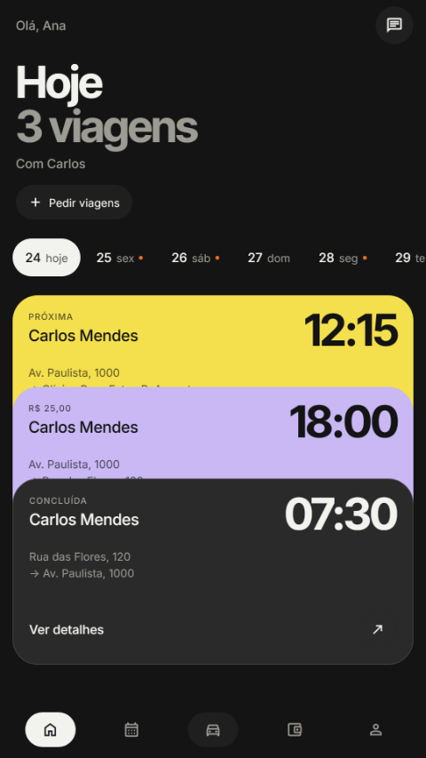
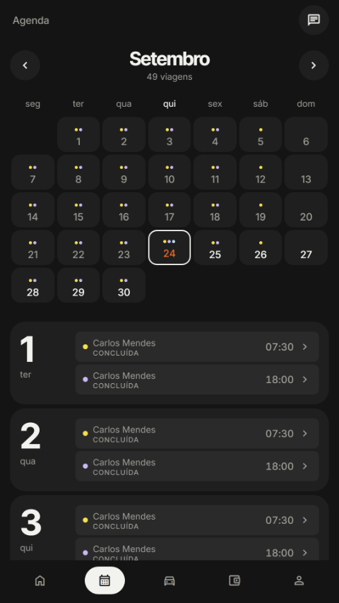
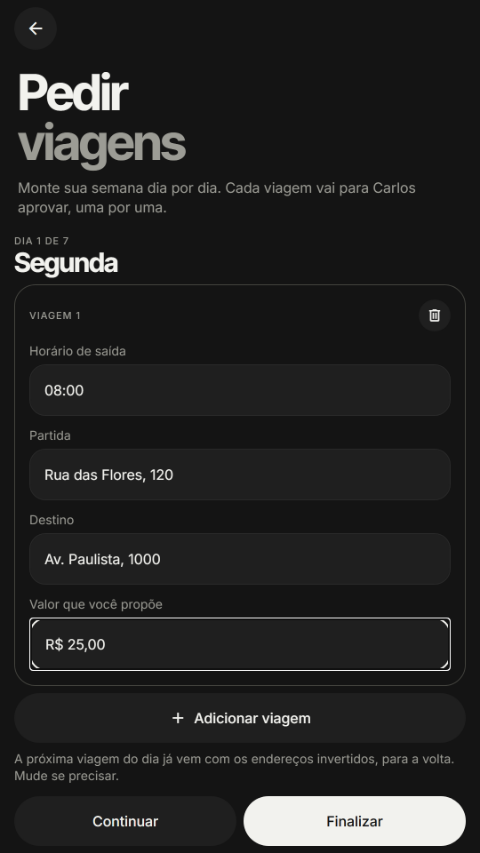
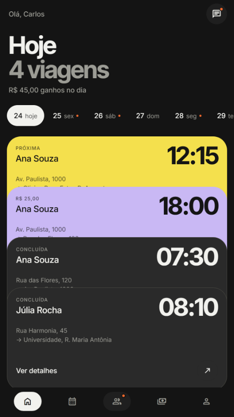
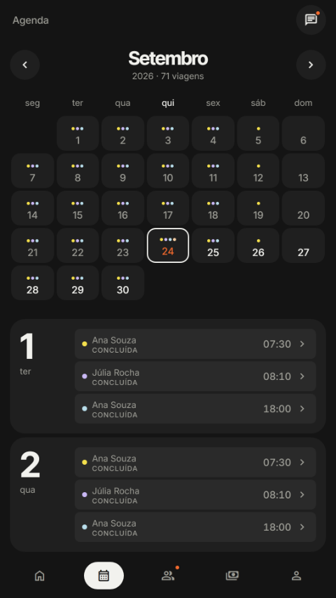
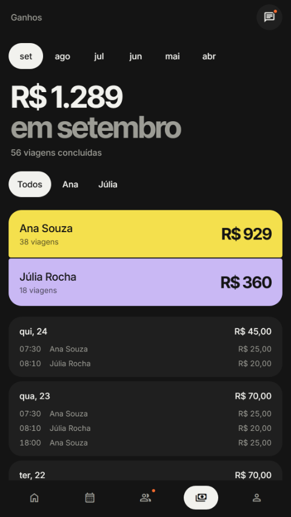

# TrustCab

Two Android apps for people who drive friends, family and neighbours for a living — and for the passengers who ride with them.

Not a marketplace. A passenger never browses drivers: they arrive through one driver's invite link, that driver approves the connection, and from then on the two of them are the whole network. Every trip is proposed by the passenger and approved by the driver, one at a time.

Personal project. Product definition, interaction design, design system and implementation by [Guilherme Kerber](https://github.com/GuiKerber).

---

## The problem

Informal drivers in Brazil run their week on WhatsApp: a thread per passenger, addresses retyped every morning, prices agreed in the middle of small talk, and no way to see how much the week actually made. Ride-hailing apps solve none of this — they replace the relationship instead of supporting it.

TrustCab keeps the relationship and removes the bookkeeping.

## Screenshots

**Passenger** — the week ahead, the agenda, and the day-by-day request flow.

<p>
  
  
  
</p>

**Driver** — today's trips, the agenda, and earnings.

<p>
  
  
  
</p>

## Product decisions worth reading

These are the calls that shaped the interface more than any visual choice.

**Invite, not search.** One revocable link per driver, and every request needs approval. It removes the entire trust problem from the product: there are no strangers to rate, report or verify. The cost is that growth is manual, which is the right trade for the first version.

**The passenger names the price, the driver answers.** No "to be agreed", no fare table. The passenger proposes a value when requesting; the driver accepts or declines each trip. Money never moves through the app — payment happens over Pix, outside it, and the passenger taps "I paid" for the driver to confirm. That kept the product out of financial regulation and out of a payment integration.

**Requesting a week, one day at a time.** The first version put Monday-to-Friday on a single screen with tabs. It tested badly: people lost track of which day they were editing. It became a step-by-step flow — one screen per weekday, *Continue* moves forward, *Back* returns to the previous day, and a final review lists the whole week before sending.

**"Recurring" as a checkbox, not a date range.** The earlier design asked *until when* (only September, only October, every month). Nobody thinks about their commute that way. Now each trip in the review has a single checkbox: checked, it repeats every week until you stop it; unchecked, it applies to the next date only.

**One driver per passenger.** In the MVP a passenger is connected to exactly one driver, so card colours identify *trips*, not people, and the chat opens straight into the conversation instead of a list.

## Design system

A single design system serves both apps, documented in Storybook and enforced in code.

- **Tokens in three layers** — raw primitives, then semantic roles, then component values. No component uses a colour, size, space, radius, opacity or duration that is not a token. `packages/ui/src/theme/tokens.ts`
- **34 components**, each with a story covering every state: default, hover, focus, pressed, disabled, loading, error and empty.
- **Accessibility as a requirement** — 4.5:1 minimum text contrast, 48dp touch targets, visible focus, never colour alone to convey state, and `prefers-reduced-motion` respected.
- **A contrast audit that removed tokens.** Six neutral tones sat within 1.15:1 of each other — indistinguishable on screen, but multiplying decisions. They were merged into three.
- **Story tests.** `npm run test:stories` renders every story and fails on the ones that break, so the system cannot drift silently.

## Architecture

npm workspaces monorepo.

```
apps/passenger      TrustCab — the passenger app
apps/driver         TrustCab Driver
packages/ui         design system + Storybook (shared by both apps)
packages/core       domain rules, types, formatting, auth, notifications, links
firebase            Firestore rules, Cloud Functions, Hosting
```

**Apps** — Expo SDK 57, React Native 0.86, expo-router with typed routes and `Stack.Protected` guards, react-native-web for the browser demo.

**Backend** — Firebase (Firestore, Auth, Cloud Messaging, Hosting) with Cloud Functions v2 in `southamerica-east1`: `invitePage`, `rotateInvite`, `deleteAccount`, and triggers for connections, agendas, trips, messages and profile changes that write system messages into the chat and send push notifications.

**Invite links that survive installation.** The link is `https://trustcab-9bab6.web.app/i/<token>`. With the app installed, Android App Links open it directly. Without the app, the page sends the user to the Play Store carrying `referrer=invite=<token>`; on first launch the app reads the install referrer and opens the invite by itself. A typed code is the fallback.

**Current state:** both apps run on local sample data. The Firestore rules and Cloud Functions are written and deployed; wiring the app screens to them is the next step.

## Running it

```bash
npm install
npm run passenger    # passenger app
npm run driver       # driver app
npm run storybook    # design system, port 6006
```

Verification: `npm run typecheck` and `npm run test:stories`.

The apps need a development build for Android (Firebase and Google Sign-In are native). Web runs from the commands above.
